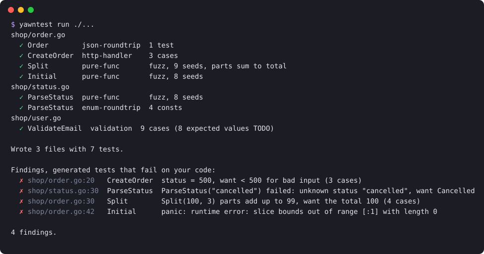

# yawntest

[](https://github.com/Mirac61/yawntest/actions/workflows/ci.yml)

**Writes the boring tests for your Go code.** Offline, deterministic, no AI, standard library
only.



That's a real run on [`_example/`](_example/), a small shop package with four planted bugs:
a handler that answers bad input with a 500, a split that loses cents, a panic on empty
input, and an order status the parser forgot. All four are found, each pointing at the line
to fix.

yawntest reads your source, recognizes common shapes (HTTP handlers, JSON structs, pure
functions, validators, encode/decode pairs, enums) and generates tests for them. It never
guesses what your code *should* return. It only checks things that hold no matter what your
business logic is: no panic, bad input never gives a 5xx, JSON survives a round trip, the same
input gives the same output, `Parse(Format(x))` gives `x` back, every enum value parses back
from its `String()`, split amounts add up to the total. When a generated test fails on your current code, that's a
**finding**, a likely bug.

## Install

```bash
go install github.com/Mirac61/yawntest/cmd/yawntest@latest
```

Needs Go 1.23 or newer, and `git` for `--changed` and `--since`. Prebuilt binaries for Linux,
macOS and Windows are on the [releases page](https://github.com/Mirac61/yawntest/releases).
For GitHub Actions there's an action, see [In CI](#in-ci).

### Versioning

yawntest follows [SemVer](https://semver.org) and is pre-1.0: between `0.x` minor versions the
CLI and its output can change. That covers commands and flags, exit codes, the JSON shape and the
names of generated files. New checks can also add findings to code that was clean before. If
you gate CI on yawntest, pin a version (`@v0.3.0`). `yawntest --version` prints the one you have.

## Usage

```bash
yawntest <command> [flags] [path]     # path defaults to ".", "./..." works too
```

| Command | What it does |
|---|---|
| `check` | Write nothing. List untested candidates, domain hints and error paths no test reaches |
| `gen` | Generate tests for every untested candidate below `path` |
| `run` | `gen`, then run the generated tests and report failures as findings |

| Flag | Commands | What it does |
|---|---|---|
| `--changed` | all | Only look at code changed since the last commit (`git diff HEAD` plus untracked files) |
| `--since <ref>` | all | Only look at code changed since the merge base with `ref`, e.g. `origin/main`: what a pull request changes, uncommitted work included |
| `--format <f>` | all | `text` (default), `json`, or `github` for annotations in GitHub Actions |
| `--json` | all | Short for `--format json` |
| `--static` | `check`, `gen` | Run no tests. Faster, but no error paths, and only names count as tested |
| `--force` | `gen`, `run` | Overwrite existing yawntest files |

Flags can go before or after the path.

**Exit codes:** `0` all good, `1` something to look at (untested candidates or error paths
with `check`, findings with `run`), `2` yawntest itself failed. Hints and tests that only
need setup never cause a `1`, so `yawntest check` and `yawntest run` can gate CI.

## What it generates

| Pattern | Detected when | Generated test |
|---|---|---|
| `http-handler` | `func(http.ResponseWriter, *http.Request)`, function or method, or a constructor returning `http.HandlerFunc` | Empty request must not give a 5xx. If the body is decoded as JSON: invalid and empty bodies must give a 4xx |
| `json-roundtrip` | Exported struct with `json` tags | Fills every field with a non-zero value, marshals, unmarshals, compares with `reflect.DeepEqual` |
| `pure-func` | Exported function, only basic-typed params (numbers, strings, bools, `time.Time`, slices of them), has a result, no I/O in its body | Native Go fuzz test seeded with edge values. Checks no panic and that two calls return the same result |
| `validation` | Returns only `error` or `bool` and is named `Validate*`, `IsValid*`, `Check*`, or takes a single string. No I/O in its body | Table of edge inputs that must not panic. The expected result is a `TODO(yawntest)` with `t.Skip`, since that's your decision. Named validators also get "empty input is rejected" |
| `roundtrip` | Two pure funcs `FormatX`/`ParseX` (also `Encode`/`Decode`, `Marshal`/`Unmarshal`, `Escape`/`Unescape`, `Quote`/`Unquote`, `Compress`/`Decompress`, `Serialize`/`Deserialize`, `To`/`From`) whose types line up: `T → U` and `U → T`, either side may also return an error | Fuzz test: decoding what was encoded gives the input back, and decoding never fails on it. Inputs are strings, `[]byte`, integers and bools |
| `enum-roundtrip` | `ParseX(string) (T, error)` where `T` has a `String() string` method and typed consts, iota blocks included | Table test: `ParseX(c.String())` gives back `c` for every const. Names like `Unknown`, `Invalid`, `numX` or `maxX` are left out |

Each source file gets one test file next to it, `order.go` → `order_yawntest_test.go`, in the
same package. User-written test files are never touched. A second run without `--force`
changes nothing.

### A generated test

From the example, the handler test that found the 500:

```go
// yawntest: http-handler / bad input never gives 5xx, invalid JSON gives 4xx
func TestYawntest_CreateOrder_BadInput(t *testing.T) {
	tests := []struct {
		name    string
		method  string
		body    string
		want4xx bool
	}{
		{name: "empty request", method: http.MethodGet},
		{name: "invalid json", method: http.MethodPost, body: "{", want4xx: true},
		{name: "empty json body", method: http.MethodPost, want4xx: true},
	}

	for _, test := range tests {
		t.Run(test.name, func(t *testing.T) {
			defer func() {
				if r := recover(); r != nil {
					t.Errorf("panic: %v", r)
				}
			}()
			handler := CreateOrder
			request := httptest.NewRequest(test.method, "/", strings.NewReader(test.body))
			recorder := httptest.NewRecorder()

			handler(recorder, request)

			status := recorder.Code
			if status >= 500 {
				t.Errorf("status = %d, want < 500 for bad input", status)
			}
			if test.want4xx && status < 400 {
				t.Errorf("status = %d, want 4xx", status)
			}
		})
	}
}
```

And the validator test, where yawntest leaves the business decision to you:

```go
// yawntest: validation / no panic; expected results are up to you
func TestYawntest_ValidateEmail(t *testing.T) {
	tests := []struct {
		name  string
		input string
	}{
		{name: "empty", input: ""},
		{name: "space", input: " "},
		{name: "single char", input: "a"},
		{name: "very long", input: strings.Repeat("x", 10000)},
		{name: "unicode", input: "ünïcødé"},
		{name: "emoji", input: "😀"},
		{name: "null byte", input: "\x00"},
		{name: "sql injection", input: "' OR 1=1 --"},
	}

	for _, test := range tests {
		t.Run(test.name, func(t *testing.T) {
			// (panic recovery omitted here)
			err := ValidateEmail(test.input)
			t.Skipf("TODO(yawntest): expected result for %s; got %v", test.name, err)
		})
	}
}
```

Replace the `t.Skipf` line with the result you expect and the case becomes a real test.

### Invariants

For a few shapes yawntest checks more than "no panic, deterministic":

- **Parts sum to total:** a pure func taking an integer amount first (`total`, `amount`,
  `price`, …) and returning a slice of the same type, like `Split(total int64, parts int) []int64`.
  Gets extra seeds that don't divide evenly (100/3, 999/7).
- **End not before start:** a pure func returning `(start, end time.Time)`, or two times from
  a func named like `WeekRange`.
- **Idempotent:** a pure func named `Normalize*`, `Canonical*`, `Clean*` or `Slugify` with one
  param and a result of the same type. Normalizing a normalized value must not change it.

"Pure" looks into the package: a func that calls a helper doing I/O isn't pure, even if the
helper lives in another file.

## Checking without writing

```text
$ yawntest check ./...
shop/order.go
  Order        json-roundtrip  line 11  has json tags
  CreateOrder  http-handler    line 20  handler signature, decodes JSON body
  Split        pure-func       line 30  basic params, no I/O
  Initial      pure-func       line 42  basic params, no I/O
shop/status.go
  ParseStatus  pure-func       line 30  basic params, no I/O
  ParseStatus  enum-roundtrip  line 30  Status has String and consts
shop/user.go
  ValidateEmail  validation  line 13  name Validate*, returns error

7 untested candidates in 3 files.

Hints:
  shop/order.go:15  money  Price is a float64; floats can't hold cents exactly, use integer cents or a decimal type
  shop/order.go:52  dates  time.Now().Year() depends on the server's time zone; call .UTC() or .In(loc) first
  shop/user.go:20   auth   Password compared with ==; use subtle.ConstantTimeCompare so the timing doesn't leak it

Error returns no test reaches:
  shop/order.go:47   return 0, fmt.Errorf("parse quantity %q: %w", s, err)
  shop/status.go:39  return 0, fmt.Errorf("unknown status %q", s)
  shop/user.go:15    return errors.New("email needs an @")

3 untested error paths.
```

- **Untested candidates:** code matching a pattern that no test file in the same directory
  mentions by name, and whose body the package's own tests never run (so a handler tested
  through a router counts as tested).
- **Hints:** money in floats (`amount`, `price`, `cost`, `balance`, `fee`), `time.Now()` read
  as a calendar value without a time zone, and secrets (`password`, `token`, `secret`,
  `session`) compared with `==`. Advice only, they never fail the check.
- **Error paths:** yawntest runs your tests with coverage and lists the error returns no test
  reaches, if a plain unit test could reach them: errors your code makes itself
  (`errors.New`, `fmt.Errorf`, `ErrNotFound`, `&ParseError{…}`) and errors passed on from calls
  that only depend on their input (`strconv`, `url.Parse`, `json.Unmarshal`, a pure func of
  the same package). Errors passed on from I/O (`os.ReadFile`, a database, an HTTP client) are
  left out, since reaching them needs fakes. Packages without any tests are named once instead
  of listing every return. Here the example's own test only covers the happy path of
  `ParseQuantity`.

`check` runs your tests to get coverage, the same way `go test -cover` does. If that's too slow
or your tests need a database, `--static` skips it.

## Ignoring code

Put `//yawntest:ignore` in the doc comment of a func or type to leave the whole declaration
out: no candidate, no hints, no error paths. Anywhere else it covers its own line and the one
below. Text after it is free, so you can say why:

```go
//yawntest:ignore talks to the payment provider, covered by the e2e suite
func Charge(w http.ResponseWriter, r *http.Request) { … }

if err != nil {
	return fmt.Errorf("render: %w", err) //yawntest:ignore can't happen, the template is static
}
```

## In CI

With the GitHub Action, candidates, hints, error paths and findings show up as annotations on
the pull request diff, and the full report lands in the job summary:

```yaml
jobs:
  yawntest:
    runs-on: ubuntu-latest
    steps:
      - uses: actions/checkout@v7
        with:
          fetch-depth: 0 # only-changed needs the base branch
      - uses: actions/setup-go@v7
        with:
          go-version-file: go.mod
      - uses: Mirac61/yawntest@v0.3.0
        with:
          command: check     # or run, to also execute the generated tests
          only-changed: true # only what the pull request changes
```

| Input | Default | What it does |
|---|---|---|
| `command` | `check` | `check`, `gen` or `run` |
| `path` | `./...` | Packages to look at |
| `working-directory` | `.` | Where to run, e.g. a module inside a monorepo |
| `only-changed` | `false` | On pull requests, `--since origin/<base branch>` |
| `args` | | Extra flags, e.g. `--static` |

The step fails with the exit code, so it gates the merge. Use `continue-on-error: true` to only
annotate. Without the action, any CI runs the same thing:

```bash
go install github.com/Mirac61/yawntest/cmd/yawntest@v0.3.0
yawntest check --since origin/main ./...
```

## Findings vs. "needs setup"

Methods are tested on a zero-valued receiver, since yawntest can't know your dependencies.
A handler that touches its database then panics. Those failures are listed apart under
"Needs setup" and don't fail the run; see [lifelog](docs/real-world.md#lifelog) for a real
example.

Fill in the receiver in the generated file, e.g. `handler := (&Server{db: testDB}).handleGit`.

## JSON

`--json` prints the same result for scripts and CI:

```json
{
  "hints": [
    {
      "file": "shop/order.go",
      "line": 15,
      "domain": "money",
      "message": "Price is a float64; floats can't hold cents exactly, use integer cents or a decimal type"
    }
  ],
  "errorPaths": [
    {
      "file": "shop/order.go",
      "line": 47,
      "code": "return 0, fmt.Errorf(\"parse quantity %q: %w\", s, err)"
    }
  ]
}
```

Keys: `candidates`, `hints`, `errorPaths`, `noTests`, `generated`, `findings`, `warnings`.
Empty ones are left out.

## Limits

yawntest reads syntax only, it never type-checks. That keeps it fast and dependency-free, and
it's why some things slip through:

- I/O hidden behind a call into another package of your module isn't seen, so such a func
  can still be treated as pure. Calls within the same package are followed.
- Slices are fuzzed with one element. Nil and empty slices are only covered in validator tables.
- Pointers, maps and nested structs stay at their zero value in JSON round trips.
- "Tested" means a test file mentions the name or the package's tests run the func. Structs
  have nothing to run, so for them only the name counts.
- Constructors with params (`NewHandler(db)`) are skipped.
- A roundtrip pair that's lossy on purpose, like `FormatBytes(1234567)` giving `"1.2 MB"`, fails
  its roundtrip test. Put `//yawntest:ignore` on the format func if that's intended.

## More

- [How it works](docs/how-it-works.md): architecture, every detection rule, design decisions
- [Real-world runs](docs/real-world.md): what yawntest found on real projects
- [Changelog](CHANGELOG.md): what changed between versions

Try it on the example yourself, from a clone of this repo:

```bash
go install ./cmd/yawntest
cd _example && yawntest run ./...
```

## License

[MIT](LICENSE)
