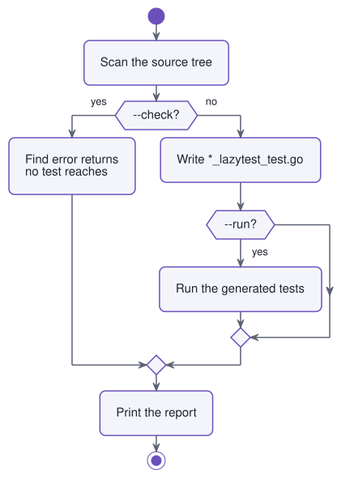
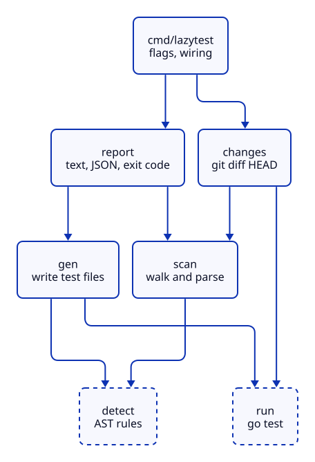

# How yawntest works

What happens between `yawntest` and a finished `*_yawntest_test.go`, every rule the detectors
use, and why things are the way they are. For usage see the [README](../README.md).

## The flow

`--changed` and `--since` filter the scan result by `git diff` before either branch. The exit code
comes from the report: `1` if there's something to look at, `2` if yawntest itself failed.

`main` only parses the command and its flags, calls `collect` to fill one `report.Result` and prints it as
text, JSON or GitHub annotations. Errors of yawntest itself are fatal, so `must(...)` ends the
program instead of passing errors up. Problems with the code under test are not: a file that
doesn't parse or a package whose tests don't build becomes a warning, and the rest is checked.

## Packages

| Package | Job | Main files |
|---|---|---|
| `cmd/yawntest` | Flags, wiring, writing files, exit codes | `main.go` |
| `internal/detect` | Read the parsed files of one package, return pattern matches, hints and error returns worth a test. Never touches disk | `package.go` (the package index and purity), `detect.go`, one file per pattern (`http.go`, `json.go`, `pure.go`, `validation.go`, `pairs.go`), one per hint (`money.go`, `dates.go`, `auth.go`), `invariants.go`, `errors.go`, `ignore.go` |
| `internal/scan` | Walk a tree, parse each directory as a package, drop what's already tested, list dirs | `scan.go`, `constraint.go` |
| `internal/gen` | Turn matches into a gofmt'ed test file | `gen.go`, one file per pattern, `seeds.go` for edge values |
| `internal/run` | Run `go test` and turn its output into findings and error paths. Coverage runs are cached and run in parallel | `tests.go`, `coverage.go` |
| `internal/config` | `.yawntest.json`: finding it, `exclude` globs with `**`, `disable` | `config.go` |
| `internal/changes` | Lines changed since `HEAD` or a merge base, and filters for scan results | `changes.go` |
| `internal/report` | Text, JSON and GitHub output, the exit-code decision | `text.go` (sections and layout), one file per section, `summary.go`, `result.go`, `json.go`, `github.go` |

Shortcuts are left out: `cmd` also imports `scan`, `gen` and `run` directly, and `changes`
imports `detect`, but each already reaches them through another arrow. `detect` and `run` import nothing else from yawntest,
and only the standard library is used, no `golang.org/x/tools`.

Dashed arrows are imports. The diagrams are PlantUML; sources and the render command are in
[`diagrams/`](diagrams/).

## Scanning

- Skips the dirs the go tool skips: `vendor`, `testdata`, and anything starting with `.` or `_`
  (that's why `_example/` doesn't show up in yawntest's own checks).
- Parses each directory's files together and builds a `detect.Package` from the non-test ones:
  every func, method and typed const. Detection then sees across files.
- Files with a `// Code generated … DO NOT EDIT.` header produce no candidates, but stay in the
  package, so a generated helper doing I/O still makes its callers impure.
- A file that doesn't parse is skipped with a warning.
- Identifiers in a directory's `_test.go` files go into a set. A match counts as tested if its
  name (`Validate` for `User.Validate`) is in that set. Selectors on other imports don't count:
  `strings.Split` in a test says nothing about the package's own `Split`.
- Funcs that are left count as tested if the directory's tests run their body: one
  `go test -coverprofile` per directory with tests. That catches handlers tested through a
  router, whose names never appear in a test. `gen` skips yawntest's own tests with
  `-skip '^(Test|Fuzz)Yawntest_'` so `--force` still rewrites their files; `check` counts them
  and shares the run with the error paths. If the tests don't build, the names decide alone.
- `.yawntest.json` (package `internal/config`) is looked for in the path and the dirs above it,
  up to the first one with `go.mod` or `.git`. `exclude` is applied while walking, so an
  excluded dir is never parsed; `disable` filters the scanned files before anything else, and
  `error-paths` there also saves the coverage runs.
- `//yawntest:ignore` drops matches, hints and error returns: in a doc comment for the whole
  declaration, elsewhere for its own line and the next.
- When generating without `--force`, existing yawntest files count as tests, so a second run
  does nothing. With `--force` they don't, and the files get rewritten.
- Each source file remembers its build constraint, from a `//go:build` line or a file name like
  `open_linux.go`. The yawntest file gets the same constraint.

## Detection

All detection works on the AST alone. Imports are resolved through the file's import table,
so `nethttp.Request` with `import nethttp "net/http"` is still recognized. Functions are tried
in the order http-handler → validation → pure-func, and the first hit wins. roundtrip and
enum-roundtrip are checked on top, since they test a property of two declarations.

**Purity** is decided once per func and cached: a body is impure if it starts a goroutine,
touches an I/O package, or calls a func of the same package (or a method on its own receiver)
that is impure. Recursion counts as pure while it's being decided. Calls into other packages of
the module aren't followed.

Functions without a body and methods on generic types (`Box[T]`) are skipped, since a test
can't call them.

### http-handler

- Two params `http.ResponseWriter` and `*http.Request`, as a function or a method.
- Or a function returning `http.HandlerFunc`. With params it's skipped later, because yawntest
  can't invent its dependencies.
- Records whether the body calls `json.NewDecoder` or `json.Unmarshal`. Only then do the
  invalid-JSON cases get generated.

### json-roundtrip

- Exported, non-generic struct with at least one `json` tag that isn't `json:"-"`.
- Fields that get a value: exported, named, not `json:"-"`, and of a type gen can build.
  Embedded structs, pointers, maps and nested structs stay at zero, which still round-trips.

### pure-func

- Exported, no receiver, no type params, at least one param and a result.
- Every param is a basic type, `time.Time`, a slice or a variadic of those.
- The body, and every func of the package it calls, touches none of these: `go` statements,
  the packages `os`, `io`, `bufio`, `net`, `net/http`, `database/sql`, `log`, `syscall` and
  the `rand` packages, `time.Now`/`Since`/`Sleep`/`After`/timers, `filepath.Abs`/`Glob`/
  `Walk`/`EvalSymlinks`, or `fmt.Print*`/`Fprint*`/`Scan*`. `fmt.Sprintf` is fine.

### validation

- Exactly one result, `error` or `bool`.
- And either a name starting with `Validate`, `IsValid` or `Check` at a word boundary
  (`checkName` yes, `Checkout` no) with one param, or zero params on a method like
  `User.Validate()`.
- Or a single `string` param. Struct params only count via the name: `Save(u *User) error`
  has the same shape and validates nothing.
- No I/O in its body, same rule as pure-func. The generated table calls it with `"a"`, `" "`
  and friends, so `Delete(path string) error` must not qualify.

### roundtrip

- Two exported, pure, plain funcs whose names pair up at a word boundary with the same rest:
  `FormatPrice`/`ParsePrice`, `Encode`/`Decode`, `MarshalID`/`UnmarshalID`, and likewise
  `Escape`/`Unescape`, `Quote`/`Unquote`, `Compress`/`Decompress`, `Serialize`/`Deserialize`,
  `ToX`/`FromX`.
- One param each. The encode side is `T → U` or `T → (U, error)`, the decode side `U → T` or
  `U → (T, error)`, compared as written in the source.
- `T` is a string, `[]byte`, an integer or a bool. Floats and times are left out: rounding and
  monotonic readings make "the same value back" a matter of taste.
- The test fuzzes `T`. An input the encoder refuses is skipped, a decode error fails, and so
  does a different value back (`bytes.Equal` for `[]byte`, so nil and empty count as equal).

### enum-roundtrip

- `ParseX(s string) (T, error)` where `T` is a type of the package with a `String() string`
  method on a value receiver (a pointer receiver can't be called on a const).
- The consts typed `T`, including the implicit ones of an iota block, minus names with the
  words `unknown`, `invalid`, `undefined`, `unspecified`, `unset`, `max`, `count`, `num` or
  `sentinel`: those usually mean "no value" or a bound and don't parse back.
- The test is a table with one case per const.

### Invariants (pure funcs only)

| Invariant | Rule |
|---|---|
| parts sum to total | First param is an integer named like `total`, `amount`, `price`, `cost`, `balance`, `fee`, and the only result is a slice of that type |
| end not before start | Two `time.Time` results named like `start/from/begin` and `end/to/until/due/deadline`, or unnamed from a func named like `*Range`, `*Period`, `*Window` |
| idempotent | Named `Normalize*`, `Canonical*`, `Canonicalize*`, `Clean*` or `Slugify`, one param and a result of the same scalar type. `Sanitize` and `Escape` are left out: escaping twice gives a different string |

Names are split into words first (`unitPrice` → `unit`, `price`; `HTTPServer` → `http`,
`server`), so `feedback` never matches `fee`.

## Hints

| Domain | Fires on | Left alone |
|---|---|---|
| money | Field, param or var of type `float32/64` named with `amount`, `price`, `cost`, `balance`, `fee` | `total` (mostly counts and layout values), untyped `var x = 4.99` |
| dates | `time.Now()` directly followed by a calendar read: `.Year()`, `.Month()`, `.Day()`, `.Format(…)`, `.AddDate(…)`, … | `.UTC()`, `.In(loc)`, `.Add`, `.Sub`, `.Unix()`, comparisons, `start := time.Now()` |
| auth | `==` or `!=` where one side is named with `password`, `token`, `secret`, `session` | Comparisons with `nil`, `""` or a number |

The first versions of the money and dates rules fired far too often on real projects, see
[real-world runs](real-world.md#what-the-real-projects-changed-in-yawntest).

## Generation

One `gen.File` call per source file. A `builder` collects test bodies and imports, then one
template wraps them with the header, the build constraint and a sorted import block, and
`go/format` formats the result. Same input, byte-identical output.

### Edge values (`seeds.go`)

| Type | Values |
|---|---|
| string | `""`, `" "`, `"a"`, 10 000 × `x`, `"ünïcødé"`, `"😀"`, `"\x00"`, `"' OR 1=1 --"` |
| signed ints | `0, 1, -1, MaxIntN, MinIntN` |
| unsigned ints | `0, 1, MaxUintN` |
| floats | `0, -0, 0.1, -1, 1e308 / MaxFloat32, NaN, +Inf` |
| `[]byte` | `nil`, empty, `"a"`, 10 000 zero bytes |
| `time.Time` | Unix 0, 2024-02-29 (leap day), 9999-12-31, one second before 1970, 2026-01-01 midnight and the second before, both 2026 Berlin DST switches |
| bool | `false, true` |

### How each pattern becomes a test

- **Fuzz tests:** One `f.Add` row per seed. With several params, shorter seed lists wrap
  around. Go fuzzing can't take `time.Time` or `[]string`, so times are fuzzed as Unix seconds
  and slices as one element, then converted inside the fuzz body. Params named `t`, `f`, `got`
  or like an imported package get renamed (`arg1`), so they don't shadow anything.
- **Determinism check:** Calls the function twice and compares with `reflect.DeepEqual`.
  Results that print the same count as equal too, because `NaN != NaN`.
- **Validator tables:** Every case runs and then `t.Skipf("TODO(yawntest): …")`. yawntest never
  writes an expected business value. Only named validators with a string param get the extra
  "empty input is rejected" test.
- **Panics:** Every test body starts with a `recover`, so one panic fails one test and the
  rest of the package still runs. For methods the message names the zero-valued receiver as
  the likely cause.
- **No shared helpers:** Several yawntest files often end up in one package, and a helper func
  declared in each of them wouldn't compile.

## Running tests (`run`)

1. Every directory holding a yawntest file runs `go test -json -run '^(Test|Fuzz)Yawntest_' .`
   on its own, so nested modules work and user tests stay out. A few directories run at once.
2. Every failing leaf test becomes a finding. A parent that only failed because a subtest
   failed is dropped.
3. The message is the first meaningful output line without the `file.go:12:` prefix. A fuzz
   seed's panic is printed under the parent test, so yawntest falls back to the parent's output.
4. A package that doesn't build becomes one finding with the compiler error.
5. Findings whose message ends with the zero-receiver note are marked `NeedsSetup`. They're
   listed apart and don't change the exit code.
6. The report folds the failed cases of one test func into one line and maps it back to the
   source match, so it shows `shop/order.go:30  Split` instead of `FuzzYawntest_Split/seed#5`.
   The longest generated name wins: `Server_Create_BadInput` belongs to `Server.Create`.
   Colors only go to a terminal, and `NO_COLOR` turns them off.

## Fuzzing (`run --fuzztime`)

After the seed run, `go test -list '^FuzzYawntest_'` lists each dir's generated fuzz tests.
Targets with a failed seed are skipped, since fuzzing would only find the same thing. The rest
run one after another with `go test -run '^$' -fuzz '^FuzzYawntest_X$' -fuzztime D`: go fuzzes
one target per call and uses every core for it, so running several at once gains nothing. A
failure becomes a finding named after the saved input (`FuzzYawntest_X/<id>`), so the rerun
command runs exactly that input.

## Untested error paths (`check`)

1. `detect` lists the error returns worth a test, in funcs and func literals whose last result
   is `error`. The last returned value decides:
   - Made here: `errors.New`, `fmt.Errorf` without a wrapped error, `ErrFoo`/`errFoo`,
     `pkg.ErrFoo`, `io.EOF`, `&FooError{…}`.
   - A variable: its last assignment before the return decides, e.g. `n, err := strconv.Atoi(s)`.
   - A wrap like `fmt.Errorf("…: %w", err)` or `errors.Join(err)`: as testable as what it wraps.
   - A call: testable if it only depends on its input, i.e. a pure func or method of the
     package, or `strconv`, `encoding/json`, `encoding/hex`, `net/url`, `regexp`, `time.Parse`
     and the like. Anything else, an I/O package or a method on some value, is left out.
   - Params and named results can't be traced and are left out.
2. Every directory with such returns and with tests runs `go test -coverprofile`, a few at a
   time. A directory without any test is reported once by name instead. A failing test still
   writes a profile. A missing profile, or one without blocks (tests that don't build), turns
   into a warning and that directory is skipped.
3. A return is reported if it lies in an instrumented block that ran zero times and in no block
   that ran.

## `--changed` and `--since`

`git diff --unified=0 HEAD` gives the changed lines per file, plus every untracked file as
fully changed. With `--since ref`, the diff starts at `git merge-base ref HEAD` instead, so it
holds what a pull request against `ref` changes, uncommitted work included. Paths are resolved through symlinks, since macOS reports `/private/var/…` for
`/var/…`.

- `check` keeps only matches, hints and error paths whose lines changed, and runs coverage only
  for touched files.
- Generation keeps every match of a touched file, because the yawntest file is written as a
  whole and dropping matches would drop their tests.

## GitHub output (`--format github`)

Every candidate becomes a `::notice`, every hint and error path a `::warning`, every finding an
`::error`, each with `file` and `line`. GitHub shows only 10 per level and step and drops the
rest silently, so they are sorted (findings, error paths, hints, candidates, yawntest's own
warnings), cut at 10 per level, and a last notice says how many were left out; if anything is
cut, the candidates get 9 so that notice fits. GitHub Actions turns them into annotations on the diff
and hides the commands from the log. Paths are made relative to `GITHUB_WORKSPACE`, the repo
root, because that's what annotations need when yawntest runs in a subdirectory. The text
report follows, so the log still reads like a normal run. `action.yml` does the same and also
copies the text report into the job summary.

## SARIF (`--format sarif`, `--sarif file`)

The same issues as the GitHub output, from the same list (`report.issues`), as one SARIF 2.1.0
run: a rule per kind (`untested/<pattern>`, `hint/<domain>`, `error-path`, `finding`), and a
result per issue with its path relative to the repo root (`uriBaseId: %SRCROOT%`). Issues
without a file, like a package whose tests don't build, are left out: code scanning rejects
results without a location. `--sarif file` writes it next to whatever `--format` prints, which
is how the action uploads it without a second run. The output is checked against the official
schema while developing; the tests pin its shape.

## How yawntest itself is tested

| What | How |
|---|---|
| Detection | Golden files: each `internal/detect/testdata/*.go` lists matches *and* near misses, its `.golden` holds the expected matches, fields, invariants, partners and hints. `go test ./internal/detect -update` rewrites them. Error returns and `//yawntest:ignore` have table tests |
| Generation | Golden files for the generated code, plus one test that puts **all** fixtures and their generated tests into one temp module and runs `go vet` and `go test`. Two clashing yawntest files or a wrong build constraint fail there |
| Running | Temp modules with a planted panic and a broken build; `go test -json` output parsed from recorded events |
| Coverage | Temp module where one test covers only the happy path; one where a func is only reached through another, plus a yawntest test that must not count |
| `--changed`, `--since` | Temp git repos: a commit, an edit and an untracked file; a feature branch against `main` |
| Scanning | A temp package with a broken file, a helper doing I/O in another file, an ignored func and a test that only calls `strings.Split` |
| Reports | Table tests with the exact expected text, JSON and workflow commands |
| The CLI | `cmd/yawntest/main_test.go` builds the binary, runs every command on a copy of `_example` and compares exit code, stdout and stderr with `testdata/*.golden` (`-update` rewrites them) |
| The action | CI runs `uses: ./` on the example and checks the exit code |

`go test ./...` covers all of it. `go test -short` skips the parts that start the go tool or git.

## Known limits

Marked in the code with `ponytail:` comments, each naming its upgrade path:

| Where | Limit | Upgrade |
|---|---|---|
| `detect/package.go` | I/O behind a call into another package of the module isn't seen | go/types plus a call graph |
| `detect/imports.go` | Assumes the package name equals the last path element (except `/vN`) | go/packages |
| `detect/dates.go` | Only direct `time.Now().Year()` chains, not `now := time.Now(); now.Year()` | Track the variable |
| `gen/fuzz.go` | Slices are fuzzed with one element | Table tests for nil, empty, large |
| `scan/constraint.go` | Copy of go/build's GOOS/GOARCH lists | Add new ports |

## How it was built

Built in about 50 small commits, milestone by milestone. Every commit builds and passes its
tests on its own.

| Milestone | Scope | Commits |
|---|---|---|
| M1 | Scan, four detectors, the check report | `981a987` |
| M2 | Generation for json-roundtrip and pure-func, writing files, `--force` | `89d9c84` … `d83e8f5` |
| M3 | Generation for http-handler and validation | `d7c5781` … `eaefcfd` |
| M4 | Findings from running the tests, `--changed`, untested error paths | `00ee8e1` … `ed9cfed` |
| M5 | Hints, invariants, DST and midnight seeds | `baeb013` … `37a038f` |
| Extra | `--json`; fixes from running on real projects | `c8bf6e8` … `3a92189` |

`git log --oneline` shows the whole sequence.
